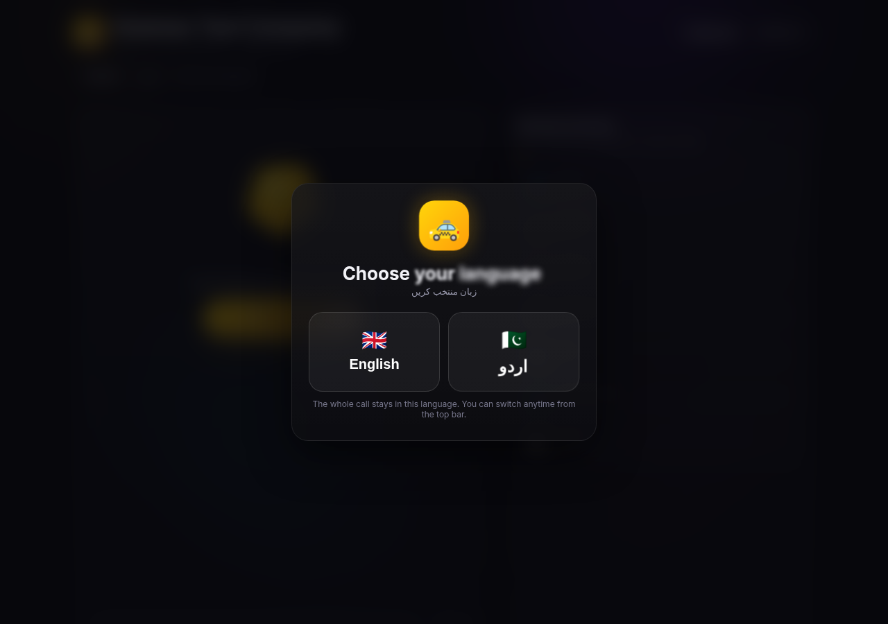
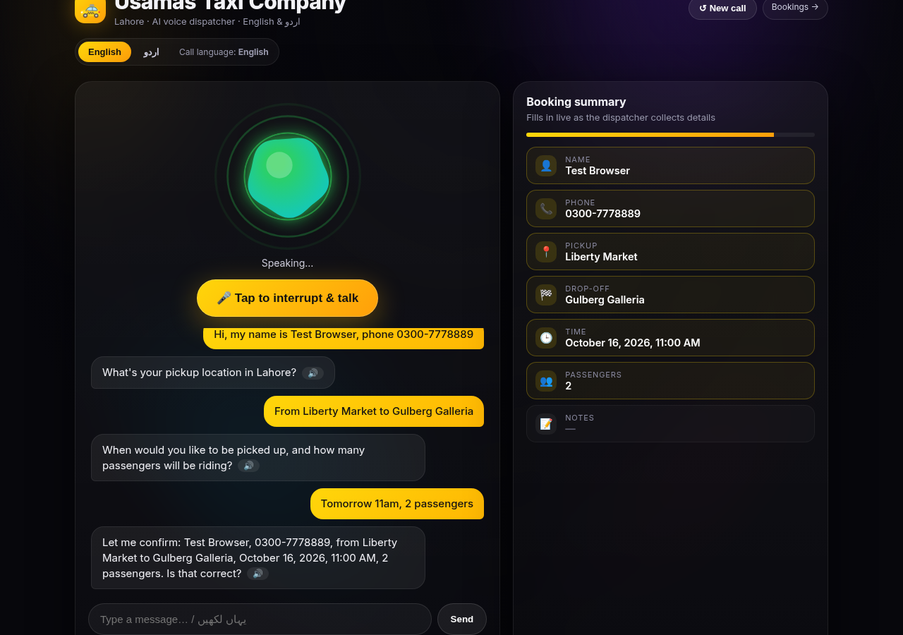
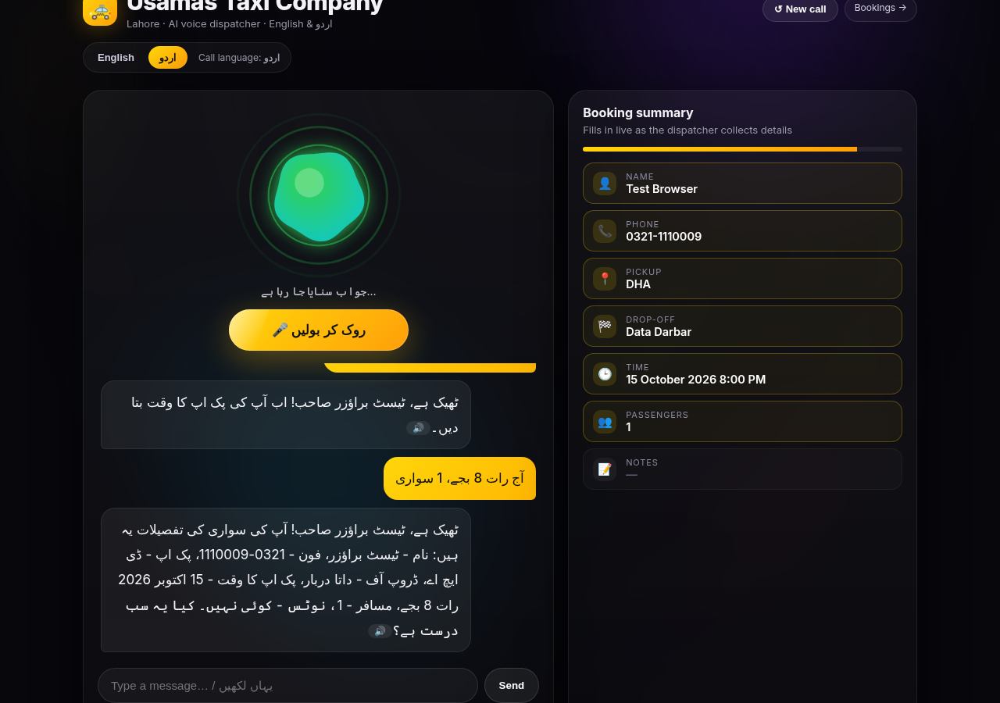
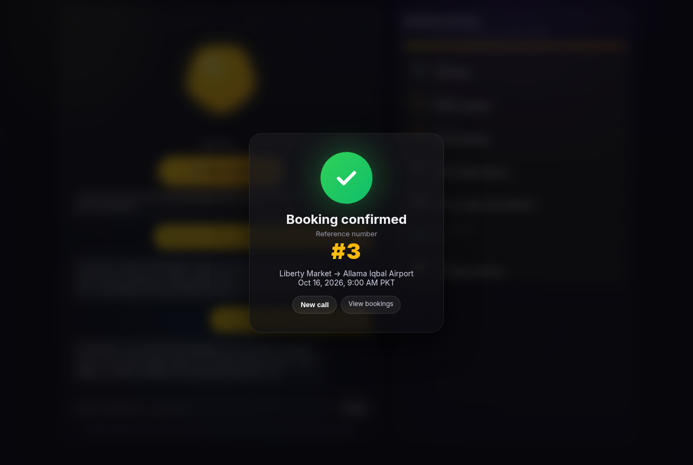
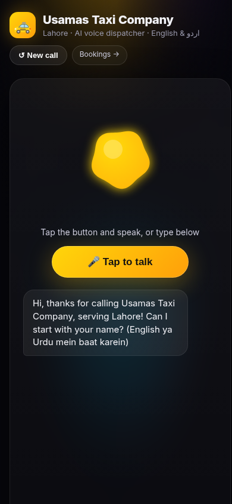

# 🚕 Usamas Taxi Company · AI Voice Dispatcher (Lahore)

A browser-based **voice AI taxi dispatcher** that takes bookings in **English or Urdu**. It runs entirely on **Cloudflare Workers**: Workers AI handles speech-to-text, the LLM and English speech; D1 stores bookings and logs; Azure Neural TTS provides a natural Pakistani Urdu voice.

Callers tap the mic and speak (or type). The dispatcher collects name, phone, pickup, drop-off, time and passengers, reads the details back, and saves the booking after a single "yes" / "جی ہاں".

<p>
  
  
</p>
<p>
  
  
</p>
<p></p>

## Features

- **Explicit language mode.** The caller picks English or اردو before the call starts. The whole call is locked to that mode: Whisper language hint, a "reply ONLY in X" instruction to the LLM, output validation with retry, and templated fallback replies. A toggle switches mode mid-call and keeps the collected details.
- **Voice UI** (React + Framer Motion):
  - aurora background and blur-in header;
  - an audio-reactive orb driven by the mic (Web Audio `AnalyserNode`), with separate thinking and speaking animations;
  - animated chat bubbles, each with a 🔊 replay button;
  - a live booking summary card;
  - a confetti success screen showing the booking reference;
  - mobile-friendly layout.
- **Reliable playback:**
  - audio is unlocked on the first tap and old audio is stopped before new audio plays;
  - TTS is retried on the server and then once more from the browser;
  - the browser's `speechSynthesis` is the final fallback, with Urdu, Hindi or English voice selection;
  - if everything fails, a "Tap to hear" prompt appears on the bubble.
- **Numbers spoken digit by digit.** A deterministic pre-TTS normalizer reads:
  - phones as `0300-1234567` → "zero three zero zero, one two three, four five six seven" (in Urdu: "صفر تین صفر صفر…");
  - booking references digit by digit;
  - times naturally ("nine thirty p.m." / "شام ساڑھے سات بجے").

  On-screen text is unchanged.
- **Urdu neural voice.** Urdu-script replies are spoken by Azure Neural TTS (`ur-PK-UzmaNeural`). If Azure is missing, errors, or runs out of quota, it falls back automatically to MeloTTS reading Roman Urdu.
- **Booking save** to D1 after one confirmation. Phone numbers are validated (Pakistani mobile `03XX-XXXXXXX` / `+92`, or landline); invalid numbers are asked for again.
- **Call logs.** Each turn and each playback result is stored in D1 (`call_logs`) and viewable at a token-protected `/logs` page.
- **Speech guards.** Empty, hallucinated ("Thank you."), repetitive or too-short recordings trigger "please repeat" instead of a wrong answer.

## Architecture

```
Browser (React SPA, single inlined HTML)
  │  MediaRecorder audio / typed text + compact state (last 6 msgs, fields, mode)
  ▼
Cloudflare Worker (src/worker.js)
  ├─ Workers AI  @cf/openai/whisper-large-v3-turbo        speech → text (language hint, VAD)
  ├─ Workers AI  @cf/meta/llama-3.3-70b-instruct-fp8-fast  dispatcher logic (JSON schema output)
  ├─ Workers AI  @cf/myshell-ai/melotts                    English speech + Urdu fallback (Roman Urdu)
  ├─ Azure Neural TTS (ur-PK-UzmaNeural, SSML → MP3)       Urdu speech
  └─ D1 (taxi_bookings)                                    bookings + call_logs
```

## Repository layout

| Path | What it is |
|---|---|
| `src/worker.js` | Worker: API, language lock, STT/LLM/TTS, normalizers, D1, logs and bookings pages |
| `ui/` | React + Vite UI source, built into one inlined `ui/dist/index.html` that the Worker serves |
| `migrations/0001_init.sql` | D1 schema (`bookings`, `call_logs`) |
| `wrangler.toml` | Worker config: AI + D1 bindings, vars, observability |
| `.dev.vars.example` | Template for local secrets |
| `docs/` | Screenshots and [demo script](docs/demo-script.md) |

## Setup & deploy

Requirements: Node.js ≥ 22 and a Cloudflare account (Workers AI and D1 free tiers are enough). An Azure resource with Speech access is optional.

```bash
npm install
npx wrangler login

# 1. Create the database, then paste its id into wrangler.toml (database_id)
npx wrangler d1 create taxi_bookings

# 2. Create the tables
npm run db:migrate

# 3. Secrets (values are never committed)
npx wrangler secret put LOGS_TOKEN          # any long random string
npx wrangler secret put AZURE_SPEECH_KEY    # optional, enables the Urdu neural voice

# 4. Set AZURE_TTS_HOST / AZURE_REGION in wrangler.toml [vars], then build and deploy
npm run deploy
```

For local development, copy `.dev.vars.example` to `.dev.vars`, then run `npm run db:migrate:local && npm run dev`.

## Configuration

| Name | Type | Required | Description |
|---|---|---|---|
| `AI` | Workers AI binding | yes | Whisper, Llama 3.3 70B, MeloTTS |
| `DB` | D1 binding | yes | Database `taxi_bookings` (see `migrations/`) |
| `LOGS_TOKEN` | secret | yes for logs | Protects `/logs`, `/api/logs`, `/api/diag` (`?token=…`) |
| `AZURE_SPEECH_KEY` | secret | optional | Azure key used to mint Speech tokens for Urdu TTS |
| `AZURE_TTS_HOST` | var | optional | Azure resource host, e.g. `your-resource.openai.azure.com` or `<region>.api.cognitive.microsoft.com` |
| `AZURE_REGION` | var | optional | Azure region (informational, e.g. `eastus`) |

## API

| Method & path | Description |
|---|---|
| `GET /` | Voice UI |
| `POST /api/turn` | One conversation turn. Multipart (`audio` or `text`) or JSON, plus `history`, `fields`, `langPref` (`en`/`ur`), `awaitingConfirm`, `sessionId`. Returns `reply`, `speak` (normalized TTS text), `audio` (MP3 data URL), `ttsPath`, `fields`, `bookingId`, `history`, `debug`. |
| `POST /api/tts` | `{ text, script?, lang }` → `{ audio, ttsPath }` (greetings, replays) |
| `POST /api/playlog` | Browser playback result beacon (stored in `call_logs`) |
| `GET /bookings` · `GET /api/bookings` | Bookings table (HTML / JSON) |
| `GET /logs?token=…` · `GET /api/logs?token=…` | Call logs (HTML / JSON). Add `&session=<id>` to view one call. |
| `GET /api/diag?token=…` | Azure key sanity check (length, short hash, token status) |

Add `?debug=1` to the UI URL to show a client-side debug panel (detected mode, transcript, source, TTS and playback path).

## Token & cost efficiency

- Short system prompt. Only the **last 6 messages** plus a compact JSON of collected fields are sent each turn.
- `max_tokens` is 160, or 320 in Urdu mode (Urdu script plus the Roman Urdu version).
- Confirmation ("yes" after the read-back) saves **without an LLM call**. "Please repeat" and invalid-phone prompts are templates.
- TTS caching: an in-memory server cache for short phrases, a browser `localStorage` cache for greetings, and Azure tokens reused for 8 minutes.
- No audio is stored, and call log fields are truncated.

## Limitations

- English speech uses MeloTTS (neutral accent). The Urdu fallback (when Azure is unavailable) reads Roman Urdu with an English voice and sounds accented.
- Whisper can mishear Lahore place names and phone digits. Phone validation catches short or long numbers, but not wrong digits.
- The LLM's Urdu wording is occasionally clumsy. Replies are validated for script and language and retried, with templates as the last resort.
- `/logs` and `/bookings`: `/logs` is protected by a single shared token, and `/bookings` is public. Add real auth before production use.
- This is a web demo, not a phone line. A telephony provider (e.g. Twilio) would be needed for real calls.

## Demo

See [docs/demo-script.md](docs/demo-script.md) for a ~3 minute presenter script with sample English and Roman Urdu calls.
